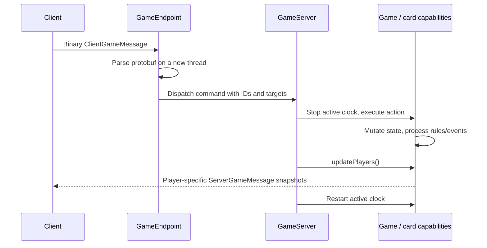
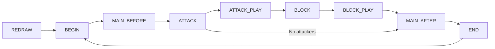

# Visitor rules engine: a code-level guide

This repository implements Visitor’s two-player card-game server in Java. A match owns mutable game objects, executes rules through Java card classes, and sends each player a Protocol Buffers view of the resulting state over WebSockets. The most useful way to understand it is to follow a command from a socket, through the `Game` API, into a card capability, and back out as a state snapshot.

Analysis baseline: engine commit `dcdd267c3cb7bf4107819b5afecd1dd2c6f50284`, with protobuf submodule `c4fbf72360949d9b6b743fdb94c35fb59db124da`. This guide describes executable code at those revisions. It distinguishes observed behavior from inferred intent and proposed improvements.

> **Follow-up fixes:** The workspace now enforces client-action legality before mutation, fixes deck insertion/routing, uses current `base2` cards in AI and draft flows, and prevents combined-zone switch fallthrough. Live matches now serialize mutations on a match worker, and effect/ability registration order is deterministic. The server suite contains 65 passing tests. See [match execution and effect ordering](MATCH_EXECUTION.md) for the current contract. The detailed analysis below records the original commit named above; findings about these issues describe the baseline before the fixes.

## 1. Repository map and runtime

| Location | Responsibility |
| --- | --- |
| `src/main/java/com/visitor/server` | WebSocket endpoints, connection routing, matchmaking, and match registry |
| `src/main/java/com/visitor/game/parts` | Match state, zone operations, legality predicates, events, stack, combat, and turn transitions |
| `src/main/java/com/visitor/game` | Players, decks, clocks, event payloads, AI responses, and drafting |
| `src/main/java/com/visitor/card` | Shared card identity and composed rule capabilities |
| `src/main/java/com/visitor/sets/base2` | 63 concrete card classes in the current main collection |
| `src/main/java/com/visitor/sets/test` | Example/test cards compiled into the application; these are not a Java unit-test suite |
| `src/main/java/com/visitor/sets/token` | Token construction helpers |
| `src/main/proto` | Git submodule containing shared wire-message definitions |
| `card-lang` | Experimental Racket reader/parser and Java-template generator |

[`pom.xml`](../pom.xml) packages a WAR and configures Jetty `9.4.36.v20210114`, `javax` Java EE APIs, protobuf `4.27.2`, and Java source/target level 9. Maven downloads and runs the configured `protoc` artifact during source generation; this path does not require a separate global `protoc` command.

The documented commands are `mvn install` and `mvn jetty:run`. Matchmaking queues, players, games, drafts, and message history live in JVM memory. Database hooks and some logging/save-state code are commented out. Restarting the process loses that runtime state.

The checked-in Maven workflow targets the old `frontend` branch, selects Java 8, and has its build command commented out. It does not establish that this Java-9-targeted server is being built or tested on `master`.

## 2. The network layer and match lifecycle

### Endpoints

| Endpoint | Class | Purpose |
| --- | --- | --- |
| `/profiles/{playerId}` | [`GeneralEndpoint`](../src/main/java/com/visitor/server/GeneralEndpoint.java#L24) | Lobby connection, collection requests, queue requests, and login/reconnect information |
| `/games/{playerId}/{gameID}` | [`GameEndpoint`](../src/main/java/com/visitor/server/GameEndpoint.java#L33) | Human-versus-human game commands and responses to game prompts |
| `/ai/{playerId}/{gameID}/{aiId}` | [`AiEndpoint`](../src/main/java/com/visitor/server/AiEndpoint.java#L30) | One human connection plus an internally routed AI participant |
| `/drafts/{playerId}/{draftID}` | [`DraftEndpoint`](../src/main/java/com/visitor/server/DraftEndpoint.java#L23) | Draft picks and draft-state messages |

The lobby endpoint’s `playerId` path value is actually used as a player name/string. An in-game player gets a separate UUID when `Player` is constructed. Neither name should be confused with a card UUID or match UUID.

[`GeneralEndpoint.gameServer`](../src/main/java/com/visitor/server/GeneralEndpoint.java#L27) is a static reference to the shared server registry. It is initialized lazily when a connection needs it.

### Starting a constructed match

1. A client opens its lobby socket and receives a `LoginResponse` containing an existing game/player ID if that name is found in an active match.
2. The client sends a `JoinQueue` with a game type and deck-list strings.
3. [`GameServer.joinQueue`](../src/main/java/com/visitor/server/GameServer.java#L144) dispatches to constructed, AI, draft, or post-draft matchmaking.
4. The server constructs a `Game` and two `Player` objects, then calls `Game.addPlayers`.
5. The game initializes trigger registries, shuffles decks, chooses the first player randomly, enters `REDRAW`, gives each player five cards, and starts the active clock.
6. The server stores the match and sends `NewGame` messages through lobby connections.
7. Clients open their match sockets. The server attaches those endpoints and resends each participant’s cached last game message.

`GameServer` is the registry and action wrapper. The actual rules are primarily methods on `Game` and its inherited classes.

### An ordinary command



The wrapper is [`takeGameAction`](../src/main/java/com/visitor/server/GameServer.java#L51). It pauses the active player’s clock, invokes the supplied operation, broadcasts state, and restarts the active clock. There is no `try/finally` around that sequence, so an exception can skip the final broadcast or clock restart.

## 3. How the `Game` class is organized

The game implementation is split through inheritance. The actual chain is:

```text
Base → Getters → Extractors → Putters → Checkers → HigherOrder
     → Connections → Messaging → Events → Stack → Combat
     → CardDelegators → PlayerDelegators → Actions → Turns
     → ClientActions → Game
```

The comment in `Game.java` is an older description; the declarations themselves are the reliable source.

[`Base`](../src/main/java/com/visitor/game/parts/Base.java#L16) stores the shared state:

- players and their connections;
- match ID, current phase, turn count, and consecutive-pass count;
- `turnPlayer`, whose turn it is;
- `activePlayer`, who currently has the next decision or initiative;
- a shared card/ability stack and `currentlyResolving` card;
- attacker and blocker IDs;
- event and trigger registries;
- last-message caches, history, and a capacity-one response queue.

This makes methods convenient to call: a card can invoke `game.draw`, `game.dealDamage`, `game.destroy`, or `game.selectFromZone` without locating separate services. The tradeoff is strong coupling: transport, waiting for clients, rule evaluation, and state mutation all belong to the same inherited object.

`turnPlayer` and `activePlayer` are distinct. On your turn, your opponent can have initiative to respond. During stack resolution the engine temporarily assigns a random UUID to `activePlayer`; that UUID is a sentinel rather than a real third player.

## 4. Players, cards, zones, and resources

### Player state

[`Player`](../src/main/java/com/visitor/game/Player.java#L23) owns a deck, hand, play area, discard pile, knowledge pool, energy values, remaining studies, a damage/health component, and a clock.

Players start at 30 health, zero energy, zero maximum energy, no knowledge, and one available regular study. Each clock starts with 20 minutes, represented internally and in snapshots as milliseconds.

Energy has three related values:

| Value | Meaning |
| --- | --- |
| `energy` | Current ordinary spendable energy |
| `maxEnergy` | Amount ordinary energy refreshes to on the owner’s new turn |
| `turnlyEnergy` | Additional temporary energy, spent before ordinary energy and cleared at end of turn |

Knowledge is a persistent threshold requirement. For example, requiring two red knowledge checks the player’s pool; playing the card does not spend those two knowledge points. Energy is deducted separately.

### Studying

[`Studiable`](../src/main/java/com/visitor/card/properties/Studiable.java) defines the basic study action. A normal study:

1. leaves the card in hand and marks it studied;
2. makes that card unplayable and prevents another regular study of it until the mark is cleared;
3. adds one current energy and one maximum energy;
4. merges the supplied knowledge gain into the pool;
5. consumes a regular study allowance when `regular` is true.

The normal legality predicate requires the card to be in hand, the player to be able to take a slow action, and a study allowance. The studied mark clears at the end of the turn or when `Card.clear()` runs. Execution and legality checking are separate, which matters for validation later in this guide.

A `Tome` is the exception: its purging study capability removes it from the hand, and it may add special study effects.

### Zones and movement

Physical containers are the player’s deck, hand, play area, discard pile, plus the match’s shared stack. Each card also carries its own `zone` field. Both must agree.

Composite zone values such as `Both_Play`, `Players`, and `Both_Play_With_Players` describe searches, not independent storage containers. `Getters.getZone` builds combined views for these queries.

Although constructor parameters are sometimes called `owner`, `Card` stores a controller UUID without a separate original-owner field. Control changes and ownership-sensitive rules therefore need care; the names in constructor signatures do not establish a distinct ownership model.

The intended lifecycle for a permanent leaving play is [`Card.moveToZone`](../src/main/java/com/visitor/card/Card.java#L145): run leave-play cleanup, extract it from its old container, then put it into the destination. Cleanup removes attachments and temporary state and schedules trigger deregistration. Low-level extraction/insertion helpers do not automatically reproduce all those lifecycle hooks.

## 5. Turns, initiative, and passing

[`Turns.changePhase`](../src/main/java/com/visitor/game/parts/Turns.java#L14) is an explicit switch-based state machine:



`BEGIN` and `END` largely run automatically through recursive phase transitions. Attack and blocker declarations are special actions that advance the phase directly.

[`ClientActions.pass`](../src/main/java/com/visitor/game/parts/ClientActions.java#L52) counts consecutive passes. The first pass gives initiative to the opponent. The second either resolves the stack or, when the stack is empty, advances the phase. Adding a card or ability to the stack resets the pass count.

After a card is played or an ability activated, initiative goes to the opponent. Studying does not explicitly hand initiative over in the same way.

### Opening hands and draw counts

Each player starts with five cards. Keeping twice advances out of `REDRAW`. Redrawing shuffles the hand into the deck and draws one fewer card.

`newTurn` has two separate draw calls: an extra draw inside `if (turnCount > 0)` and an unconditional draw afterward. Consequently:

- the first player’s first turn draws one card, normally taking their hand from five to six;
- subsequent turns draw two cards;
- the other player therefore normally starts their first turn with seven cards if they have taken no other actions.

This behavior was reproduced in an isolated runtime probe. Whether two-card turns are intended is a rules-design question; they are the current implementation.

At the start of a turn, energy refreshes, study allowance resets to one, and the owner’s cards in play run `newTurn`. At the end, both players’ cards in deck, hand, discard, and play clear turn-limited effects and studied marks. Temporary energy is cleared, and the turn player discards down to seven if necessary.

## 6. Card composition and implementing new cards

[`Card`](../src/main/java/com/visitor/card/Card.java#L28) owns identity, name/text, types/subtypes, controller, zone, depletion state, counters, and attachments. Rule behavior is supplied by capability objects:

| Capability | Responsibility |
| --- | --- |
| `Playable` | Energy cost, timing, extra costs, targeting, resolution, and destination |
| `Studiable` | Study legality and study effects |
| `Activatable` | Collections of activated abilities |
| `Triggering` | Registration and dispatch of event checkers |
| `Damagable` | Attack, health, shields, combat state, and combat keywords |
| `Attachable` | Attachment target and attach/remove callbacks |

Card-type constructors assemble sensible defaults:

- `Unit`: slow, persistent, studiable, trigger-capable, activatable, and damageable. Resolution marks it as deploying.
- `Asset`: slow, persistent, studiable, trigger-capable, and activatable.
- `Cantrip`: a fast spell that resolves to discard. The subtype itself does not automatically draw a card.
- `Ritual`: a slow spell that resolves to discard.
- `Attachment`: a slow permanent with attachment targeting and lifecycle hooks.
- `Tome`: a special study card.
- `AbilityCard`: an internal stack object that runs an ability and disappears.

The main collection currently consists of 63 Java classes in `sets/base2`. A deck entry such as `3;base2.Stormtrooper` asks the factory to construct three instances of `com.visitor.sets.base2.Stormtrooper` with a `(Game, UUID)` constructor. Each instance gets a new UUID.

The Racket `card-lang` folder contains an experimental parser and a Java-source template, but the Maven configuration does not invoke it. The template also contains an older string-owner signature. The active rule definitions in this checkout are Java constructors and callbacks.

### Three useful examples

[`Stormtrooper`](../src/main/java/com/visitor/sets/base2/Stormtrooper.java) is a one-energy 1/1 unit requiring one red knowledge. `Blitz` permits it to attack while deploying. Its self-death checker deals one damage to the opponent.

[`Barracks`](../src/main/java/com/visitor/sets/base2/Barracks.java) is a persistent asset. It registers an activated ability that depletes the Barracks, creates an `AbilityCard` on the stack, and constructs/resolves a Stormtrooper when that ability resolves.

[`FlameStrike`](../src/main/java/com/visitor/sets/base2/FlameStrike.java) is a two-energy ritual requiring one red knowledge. Its target predicate accepts an enemy unit or player. The resolution callback calculates damage from the controller’s red knowledge at resolution time.

These examples show the main extension style: choose a base type, set costs and stats, then attach predicates and lambdas using the shared engine vocabulary.

## 7. From playing a card to resolving its effect

Consider a legal Flame Strike with a target chosen by the client.

1. A snapshot supplies the card’s `canPlay` flag and targeting descriptions. Each targeting description has its own UUID, candidate IDs, minimum/maximum counts, zone, and prompt text.
2. The client sends the card UUID and `TargetSelection` records containing effect UUIDs and chosen target UUIDs.
3. `GameEndpoint` dispatches the message through `GameServer.takeGameAction`.
4. [`ClientActions.playCard`](../src/main/java/com/visitor/game/parts/ClientActions.java#L23) extracts the card and stores the supplied target selections.
5. [`Playable.play`](../src/main/java/com/visitor/card/properties/Playable.java#L127) deducts energy when requested, runs additional cost effects, and adds the card at index zero of the stack.
6. A `Play_Card` event is processed and initiative goes to the opponent. New snapshots show the stack and updated resources.
7. After two passes, [`Stack.resolveStack`](../src/main/java/com/visitor/game/parts/Stack.java#L21) removes index zero into `currentlyResolving` and calls `resolve`.
8. Resolution runs effect callbacks, places the card in its destination, then runs after-resolution effects. For Flame Strike, damage occurs before the spell goes to discard.
9. Events are processed and further snapshots communicate the result.

`currentlyResolving` is important: the resolving card is temporarily in neither a player container nor the stack, but callbacks may still need to find it as a damage source.

### Resolution policy

The stack is last-in, first-out because new entries are inserted at index zero and resolution removes index zero.

The resolver can resolve several entries after two passes. If resolution leaves a nonempty stack of the same size it had just after popping the current card, it keeps resolving while `passCount == 2`. If the stack becomes empty or that size changes, it resets passes and restores initiative to the turn player. This is a size-based heuristic, explicitly marked for replacement in a TODO. It does not implement a universal “open a response window after every resolved object” rule.

The resolver also sleeps for 500 ms per resolved item, so presentation pacing is coupled to the server action thread.

### Targets and effect ordering

[`Effect`](../src/main/java/com/visitor/card/containers/Effect.java#L19) packages a target predicate, zone, count limits, message, selected IDs, and a callback. When targets are set, it records each target’s current zone. At resolution, the targeted path checks that the target is still in the recorded zone before running the callback.

That is a useful partial safeguard, but it does not recheck every original targeting condition. It also assumes the target still exists and does not fully validate submitted count, uniqueness, or membership in the advertised candidate list.

Cost and resolution effects are stored in the project’s `Hashmap`, which extends Java `HashMap`. Iterating those values does not guarantee insertion order. A multi-effect card whose rules depend on exact sequencing needs particular attention.

The `withCost` flag controls the default energy deduction. Additional cost effects still run even when energy payment is bypassed.

## 8. Events and triggered abilities

[`Event`](../src/main/java/com/visitor/game/Event.java) contains an enum and an untyped `Arraylist<Object>` payload. Event factories define the payload conventions for play, study, entry, death, damage, attack, and turn boundaries.

[`Events.processEvents`](../src/main/java/com/visitor/game/parts/Events.java#L29) detaches the current queue into a temporary batch, then checks the turn player’s registered cards followed by the opponent’s. Afterward it deregisters cards scheduled to leave the trigger registry.

This deferred deregistration explains how a unit can still receive its own death event after moving out of play. Its trigger remains registered until the queued death event has had an opportunity to run.

`Triggering` stores `EventChecker` objects. A checker combines a predicate with an effect, such as:

- “this was my own death”;
- “my controller played a red card”;
- “this card dealt combat damage to a player”;
- “my controller’s turn began.”

Examples include Stormtrooper’s death damage, Prefire’s red-card trigger, and Blitz Robbers drawing after combat damage to a player.

A matching checker executes immediately by default. `EventChecker.createAbility` can instead wrap the trigger in an `AbilityCard`, but no calls to that option were found in the current card definitions. It would therefore be inaccurate to assume that every triggered effect automatically creates a respondable stack item.

Processing a detached batch is also different from draining events until no work remains. Newly generated events may wait for another `processEvents` call unless nested operations explicitly process them. Event ordering deserves dedicated regression tests.

## 9. Combat and damage

[`Combat`](../src/main/java/com/visitor/game/parts/Combat.java) handles match-level combat sequencing; [`Damagable`](../src/main/java/com/visitor/card/properties/Damagable.java) handles each unit/player’s damage-related state.

### Declaration and resolution

Attackers submit their own ID and a destination ID. Normal declarations deplete the attacker; `Vigilance` suppresses that depletion. `Blitz` permits attacking while deploying, and `Defender` prevents attacking.

Blocking records one blocker reference on an attacker and one attacked-unit reference on a blocker. The stored model is effectively single-blocker-per-attacker; repeated assignments overwrite that reference rather than forming an arbitrary blocker list.

Block predicates check depletion, `Unblockable`, and the interaction between `Evasive` and `Reach`. These predicates help construct client choices, but command execution does not comprehensively enforce them.

The combat-damage sequence is:

1. first-strike attackers deal damage with immediate-kill behavior;
2. events are processed;
3. other attackers deal ordinary combat damage;
4. blockers deal their damage;
5. post-combat death checks run;
6. events are processed again.

Only attackers are explicitly selected for the first-strike substep. The file also contains a TODO acknowledging that Deadly-related death checks can kill a unit even when the relevant opposing unit dealt no damage. The implemented keywords should be assessed through their actual methods, rather than treating a “Done” enum comment as full rules coverage.

### Damage semantics

- Shields reduce each incoming hit by permanent plus temporary shield. Receiving a hit does not itself spend the shield value.
- Damage consumes temporary health before ordinary health.
- Player health reaching zero ends the game.
- `Lifelink` grants health to the source’s controller.
- `Drain` heals the source card.
- `Trample` can forward excess damage through an attacking source to the blocked unit’s controller.
- `Regenerate` heals on the unit’s new turn; `Decay` reduces maximum health, current health, and attack.
- Ordinary unit damage is not automatically erased at turn end. Turn-end cleanup clears temporary modifiers and combat targeting, not all lost permanent health.

The `Damage` container separates amount, whether the hit may kill immediately, and whether it is combat damage. That distinction supports delaying ordinary combat deaths until both sides have dealt their damage.

## 10. Snapshots, prompts, hidden information, and reconnection

The protobuf files define lobby messages separately from match messages. A `ClientGameMessage` has a `oneof` payload for actions and decision responses. `ServerGameMessage` similarly contains state updates, game-end results, and prompts.

[`Messaging.toGameState`](../src/main/java/com/visitor/game/parts/Messaging.java#L183) builds a personalized full snapshot containing phase, active/turn players, stack, combat declarations, and two player views.

[`Player.toPlayerMessage`](../src/main/java/com/visitor/game/Player.java#L201) includes actual hand cards only for the receiving player. The opponent gets a hand count, alongside visible battlefield/discard cards, resources, health, and clock. Deck contents remain hidden, although deck size and color summaries are transmitted.

[`Card.toCardMessage`](../src/main/java/com/visitor/card/Card.java#L411) combines display data with calculated action flags and available target/ability descriptions. The Godot client uses this to highlight options and render the board. There is no state-version field or explicit delta stream in these messages.

The `noAction` argument to `toGameState` is currently unused. Passing `true` does not itself remove action flags from cards.

For interactive decisions, such as selecting cards, choosing knowledge, choosing X, or assigning damage, the engine sends a prompt and blocks on `response.take()`. A separate incoming message thread routes the response into the game’s capacity-one `ArrayBlockingQueue<Object>`.

That design lets a Java effect read like synchronous code while waiting for a human. Its cost is a blocked thread, an untyped response channel, and no visible timeout/correlation mechanism for distinguishing stale or concurrent decisions. The endpoint’s `waitingResponse` state provides payload-type checking, but does not replace full response validation.

The last outgoing message is cached per player for reconnects, including prompts. This provides a basic resume path but not durable recovery after a process restart.

## 11. AI and drafting: implemented paths and limits

### AI

[`AiEndpoint`](../src/main/java/com/visitor/server/AiEndpoint.java) registers the same endpoint as both human and AI connections. Human-targeted messages go to the socket; AI-targeted messages are passed to `AiPlayer.getResponse`, whose response is fed back through the command dispatcher.

[`AiPlayer`](../src/main/java/com/visitor/game/AiPlayer.java) currently keeps its opening hand, declares no attackers/blockers, and normally passes. More active play/study/activation logic is commented out. Some prompt responses are random; damage assignment returns `null`, and draft picking is not implemented.

Its built-in deck references old `base.*` card classes, whereas the current collection is `base2`. The factory logs failed class lookups and returns null, and deck construction skips null cards. This can leave the AI with an empty deck. It explains why the current AI experience is useful as a solitaire opponent, rather than evidence of a competitive bot.

There is also an attribution inconsistency: the AI endpoint uses `senderId` for several actions but the human `playerId` for play and activate commands. That path will need attention if active AI play is restored.

### Drafting

[`Draft`](../src/main/java/com/visitor/game/Draft.java) is a separate runtime. It creates two three-card choices per round, receives one choice from each player, swaps the remaining choices, receives a second choice, and repeats for three rounds. With the leftover-card allocation commented out, the nominal result is six selected cards per player.

The class still discovers `com.visitor.sets.base` and creates `base.*` cards. That package is absent in the current source tree. The class-discovery helper assumes a non-null filesystem package URL, so the stale package can fail before a draft starts. This path was inspected, not validated end to end.

## 12. Correctness and maintainability findings

The following observations explain where the current implementation can diverge from expected rules. They are analysis findings; no application fixes were made for this guide.

| Finding | Evidence and consequence | Verification |
| --- | --- | --- |
| Advertised legality is not enforced at the mutation boundary | `canPlay` checks resources/timing, but `ClientActions.playCard` and `Playable.play` do not call it before extracting a card or paying costs. Similar separation affects study, activation, pass, and combat declarations. | Local probe confirmed that a card advertising `canPlay=false` at zero energy could still be played through the game API, enter the stack, and leave energy at -1. |
| Match/player identity is trusted from the URL | Endpoint setup accepts supplied IDs without binding them to an authenticated lobby/session identity in the inspected code. | Source inspection; no external authorization test performed. |
| Game mutations can race | Match endpoints start a thread per message; `takeGameAction` is not synchronized and does not serialize commands per game. Collections are ordinary mutable `HashMap`/`ArrayList` derivatives. | Source inspection; no concurrent load test performed. |
| Combined-zone traversal falls through switch cases | `Getters.getBothZones` has no breaks. Starting at `Play` also adds discard, adds play areas again, then stack. `Combat.dealDamageToAll` calls this helper. | Local probe: two battlefield cards produced a four-entry result even with empty discard/stack. Global damage can therefore hit the same card more than once and include unintended zones. |
| Deck insertion has edge and ordering errors | `Deck.putToBottom` inserts at `size()-1`, and `shuffleInto` uses `nextInt(size())`. The top-of-deck game helper delegates to the bottom helper. | Local probe confirmed bottom insertion into an empty deck fails. The index/routing errors are explicit in source. |
| Maximum-energy addition ignores its argument | `Player.addMaxEnergy(int i)` always adds one. | Local probe: `addMaxEnergy(5)` increased maximum energy by one. |
| Fresh-copy restoration uses the wrong constructor signature | `Actions.createFreshCopy` looks up `(Game, String)`, while the normal factory and current card constructors use `(Game, UUID)`. | Reflection probe confirmed the UUID constructor exists and the String constructor does not for Stormtrooper. |
| Turn draw counts differ from a simple one-draw interpretation | `Turns.newTurn` draws both conditionally and unconditionally. | Local probe confirmed hands of six and seven for the first player’s opening turn and the second player’s opening turn. Intent remains a rules question. |

Additional concerns worth addressing include unordered multi-effect execution, incomplete target/decision validation, stale AI/draft card packages, and inconsistent deck-exhaustion handling. `Actions.draw` checks for an empty deck after drawing, but turn setup calls `Player.draw` directly, which does not perform that game-end check. Thus drawing the last card and attempting to draw from an empty deck are not handled uniformly.

Lifecycle cleanup also needs a clearer contract. Player construction starts clock threads; `getCollection` constructs dummy players/games to serialize cards, and that path has no matching clock teardown. `gameEnd` removes the game but does not explicitly stop every player clock. Endpoint `close()` methods clear their `session` field rather than invoking `Session.close()`.

## 13. A practical improvement order

1. **Centralize command validation.** Before any mutation, validate actor identity, match membership, phase, initiative, ownership, zone, resources, ability identity, legal targets, uniqueness, and target counts. Invalid commands should leave state unchanged and return an explicit failure.
2. **Serialize mutation per match.** Use a per-game command executor or equivalent ownership model. Model pending decisions explicitly so client prompts do not require arbitrary action threads to block on an untyped shared queue.
3. **Establish deterministic rules tests.** Cover turn draws, priority, empty/nonempty stack transitions, studying, all deck boundaries, duplicate targets, trigger ordering, first-strike/block interactions, and simultaneous lethal damage. Define intended outcomes where the code alone cannot settle the rule.
4. **Repair the concrete helper defects.** Zone switch fallthrough, deck insertion/routing, maximum-energy parameters, and constructor signatures are small, high-impact candidates for focused tests and fixes.
5. **Make effect ordering explicit.** Use ordered effect sequences or a documented scheduling model, and specify whether each class of trigger is immediate or goes onto the stack.
6. **Give matches a lifecycle.** Introduce an ended state, idempotent termination, clock cleanup, pending-decision cancellation, and intentional socket cleanup. Build collection metadata without starting live matches.
7. **Improve reproducibility and maintenance.** Inject randomness, record typed commands and state versions, update CI to run actual server tests on active branches, and align AI/draft card registries with the collection.

A full architectural rewrite is not required to start improving reliability. Boundary validation, deterministic helper tests, and lifecycle ownership would address several problems while preserving the existing card-capability design.

## 14. Validation performed for this analysis

- Rebuilt the current server with `mvn -B -ntp package` on the prepared Java 21 environment: **BUILD SUCCESS**.
- Maven reported **No tests to run**. The compiled test-card package is not a substitute for a test suite.
- Ran an isolated Java probe outside the repository with eight assertions covering opening-turn hand counts, the maximum-energy parameter, combined-zone duplication, empty-deck bottom insertion, unchecked play at zero resources, and constructor compatibility. All eight completed successfully and reproduced the behaviors described above.
- Reviewed the core runtime, transport, protobuf definitions, capability implementations, AI/draft paths, and representative concrete cards. This is not an exhaustive proof of all 63 card definitions or a concurrent/deployment security test.

The probe used independent local game objects and exited explicitly to avoid retaining their clock threads. No live player match was modified. The only repository addition from this analysis is this documentation file.
